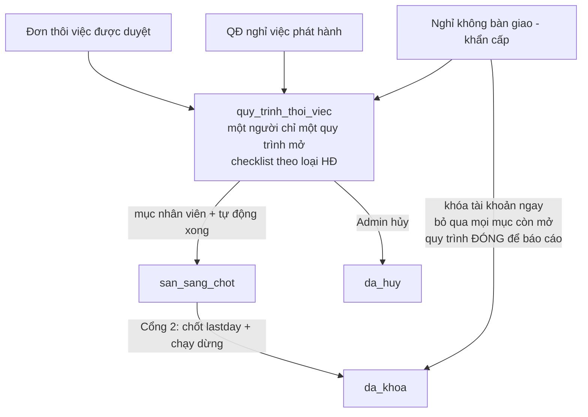

# Thiết kế: LUỒNG NGHỈ VIỆC DUY NHẤT (theo loại hợp đồng)

> Trạng thái: **chờ duyệt**. Bản này thay cách hiểu cũ "đơn thôi việc là một luồng, quyết định
> nghỉ việc là luồng khác, nút nghỉ không bàn giao là luồng thứ ba".

## 1. Nguyên tắc

1. **Một quy trình duy nhất** — `quy_trinh_thoi_viec` — cho mọi trường hợp một người rời công ty.
   Mọi cách vào đều dẫn về đúng bảng này, cùng checklist, cùng Cổng 2, cùng nhật ký.
2. **Một người chỉ có MỘT quy trình đang mở.** Ràng buộc bằng partial unique index CSDL, không
   chỉ bằng code. Đơn/QĐ đến sau chỉ **cập nhật ngày làm việc cuối** của quy trình đang mở.
3. **Nhánh do loại hợp đồng quyết định, không cho chọn tay.** `nhom_quy_trinh` được chụp lúc
   sinh quy trình từ HĐ đang hiệu lực + chức danh:
   - `thuc_tap` — học việc / thực tập sinh
   - `thu_viec` — thử việc
   - `thoi_vu` — thời vụ
   - `chinh_thuc` — HĐ xác định / không xác định thời hạn
   - `quan_ly` — HĐLĐ + chức danh quản lý doanh nghiệp
   - `cong_tac_vien` — hợp đồng dịch vụ
4. **QĐ nghỉ việc có ngày là đưa người vào luồng NGAY**, không đợi qua lastday. Thời hạn báo
   trước chính là thời gian để bàn giao.
5. **Hồi tố chỉ khi ngày cuối đã qua** (QĐ cũ, hệ thống từng lỗi, dữ liệu nhập muộn): bỏ qua
   mục nhân viên kèm lý do, không truy thu thủ tục.

## 2. Máy trạng thái

## 3. Ba nguồn vào — cùng một quy trình

| Nguồn (`nguon_tao`) | Ai tạo | Hành vi |
|---|---|---|
| `don_nhan_vien` | Nhân viên nộp đơn, Admin duyệt Cổng 1 | Sinh quy trình + checklist mở |
| `quyet_dinh` | HR phát hành QĐ nghỉ việc trên hệ văn bản AI | **Sinh quy trình NGAY trong transaction phát hành**, lastday theo QĐ, mục bàn giao mở nếu còn hạn |
| `nghi_khong_ban_giao` | Nút khẩn cấp ở hồ sơ nhân sự | Khóa tài khoản ngay; vẫn ghi một quy trình **đã đóng**, mọi mục còn mở bỏ qua kèm lý do |

## 4. Nhánh theo loại hợp đồng (căn cứ pháp luật)

| Nhóm | Loại HĐ | Báo trước | BHXH / báo giảm | Trợ cấp thôi việc | Phép năm | Quyết toán 14 ngày (Đ.48) | Tiêu đề quyết định Cổng 2 |
|---|---|---|---|---|---|---|---|
| Thực tập sinh | `hoc_viec` | Theo hợp đồng (không chặn) | **Không** | **Không** | **Không** | **Không** | Kết thúc học việc / thực tập |
| Thử việc | `thu_viec` | **14 ngày** (chính sách công ty) | Không bắt buộc | **Không** | **Không** | Có | Kết thúc thời gian thử việc |
| Thời vụ | `thoi_vu` | 3 ngày | Có (khi phát sinh) | Có | Có (khi phát sinh) | Có | Chấm dứt HĐLĐ |
| Chính thức | `xac_dinh`, `khong_xac_dinh` | **30 ngày** (HĐ xác định, kể cả dưới 1 năm) / 45 ngày (không xác định) | Có | Có | Có | Có | Chấm dứt HĐLĐ |
| Quản lý DN | HĐ **xác định / không xác định** + chức danh quản lý | **120 ngày** (Đ.7 NĐ145/2020) | Có | Có | Có | Có | Chấm dứt HĐLĐ |
| Cộng tác viên | `cong_tac_vien` | Theo hợp đồng dịch vụ | **Không** | **Không** | **Không** | **Không** | Chấm dứt hợp đồng dịch vụ |

**Điểm chặn quan trọng:** chức danh có chữ "trưởng phòng/quản lý" **không** biến thực tập sinh,
thử việc, thời vụ hay cộng tác viên thành nhánh quản lý. `nguong_bao_truoc()` trả ngưỡng riêng
của loại HĐ đó trước khi xét `la_quan_ly_dn`; nhánh `quan_ly` chỉ áp cho HĐ xác định / không
xác định thời hạn.

## 5. Việc phải làm theo từng nhánh

### Thực tập sinh (`hoc_viec`)
- Xác nhận lastday, đọc hướng dẫn, trả tài sản, thanh lý tạm ứng, gỡ dữ liệu, ký biên bản bàn
  giao, khóa tài khoản, đóng hồ sơ.
- Cam kết bảo mật, bàn giao hồ sơ, bàn giao việc dở: **khi phát sinh** (không chặn).
- **Không có** mục kiểm tra báo trước, phép năm, trợ cấp, báo giảm BHXH, giấy xác nhận BHXH,
  quyết toán 14 ngày.
- Quyết định Cổng 2 mang tiêu đề **kết thúc học việc / thực tập**, không gắn danh mục "Quyết
  định chấm dứt HĐLĐ".

### Thử việc (`thu_viec`)
- **Báo trước 14 ngày** (chính sách công ty), thời gian thử việc 30–60 ngày.
- Như trên, cộng quyết toán lương + mốc 14 ngày; không trợ cấp thôi việc, không phép năm.
- Quyết định: **kết thúc thời gian thử việc**.

### Chính thức / thời vụ / quản lý
- Đủ 23 mục theo ma trận, gồm báo trước, phép, trợ cấp, BHXH, chứng từ thuế.
- Quản lý doanh nghiệp dùng ngưỡng 120 ngày, không phụ thuộc loại HĐ.

### Cộng tác viên
- Không BHXH, không trợ cấp, không phép, không Đ.48; quyết định chấm dứt hợp đồng dịch vụ.

## 6. Thay đổi kỹ thuật

- `thoi_viec/nhanh.ts` (mới, hàm thuần): xác định nhánh, tiêu đề quyết định/bảng quyết toán,
  căn cứ pháp lý, cờ Đ.48, ngưỡng báo trước.
- `quy_trinh.ts`:
  - `sinh_quy_trinh_thoi_viec` nhận `nguon_tao`, chụp `nhom_quy_trinh`, **tái dùng** quy trình
    đang mở thay vì tạo quy trình thứ hai; đổi lastday thì đưa mục tự động về `chua` để tính lại.
  - `dam_bao_quy_trinh_tu_qd(..., { hoi_to, nguon_tao, quyet_dinh })`: tạo/duyệt đơn + quy trình;
    liên kết QĐ (số, ngày, tệp, thông báo) và tick mục `ban_hanh_qd`; `hoi_to` quyết định bỏ qua
    hay giữ mục nhân viên.
- `thong_bao_ai.ts`: phát hành QĐ → gọi `dam_bao_quy_trinh_tu_qd` **trong transaction phát
  hành**, truyền số/ngày/tệp QĐ; đánh dấu `nghi_viec_da_chay_luc`; chuông cho nhân viên + admin.
- `lich_chay.ts`: sửa lỗi khối `nghi_viec_den_han` bị lồng trong `catch` của job ra/vào; quét
  **mọi** QĐ chưa vào luồng (không lọc theo ngày) làm lưới an toàn/backfill, kèm số/ngày QĐ.
- `danh_muc.ts`: nút nghỉ không bàn giao **chỉ `can_admin`**, ghi quy trình đã đóng
  (nguồn `nghi_khong_ban_giao`).
- `chay_dung.ts`: quyết định/bảng quyết toán/BHXH theo nhánh; **dùng lại QĐ đã liên kết** thay
  vì sinh văn bản thứ hai; chỉ sinh chứng từ khi mục tương ứng có trong khuôn.
- `tu_dong.ts`: mục `ban_hanh_qd` chỉ xong khi QĐ đã liên kết — chưa có QĐ thì Cổng 2 bị chặn.
- Migration `113_luong_nghi_viec_duy_nhat.sql`: thêm `nguon_tao`, `nhom_quy_trinh`, partial
  unique index một quy trình mở/người, dọn mục không áp dụng khỏi khuôn.
- UI: cột **Nhánh** + **Nguồn tạo** ở trang Thôi việc; chi tiết hiện căn cứ pháp lý của nhánh.
- E2E: QĐ phát hành tạo quy trình ngay, mục bàn giao mở; gọi lại lịch đêm không tạo trùng;
  trường hợp hồi tố bỏ qua mục nhân viên.

## 7. Dữ liệu production cần xử lý sau khi duyệt

| Hồ sơ | Hiện trạng | Việc cần làm |
|---|---|---|
| ERP142 Nguyễn Phương Thảo — TBN-000014, nghỉ **31/10/2026** | Không có quy trình, không có mục bàn giao | Sau deploy, lịch quét tự đưa vào luồng (hoặc chạy backfill ngay) — mục bàn giao mở |
| ERP147 Hoàng Minh Ngọc — TBN-000003, nghỉ 22/09 | Đã `dang_hoat_dong=false`, không có quy trình | **Bỏ qua** khi backfill (đã nghỉ tay); chỉ đánh dấu QĐ đã xử lý |
| ERP151 Đinh Thị Cẩm Nhung — quy trình mở từ 25/09, lastday 30/09 | 7 mục nhân viên còn `chua`, lastday chưa chốt | HR nhắc nhân viên hoàn tất hoặc Admin bỏ qua từng mục kèm lý do rồi Cổng 2 |

## 8. Điểm đã chốt

1. **Thực tập sinh**: giữ quyết toán lương nhưng **không** phép năm, trợ cấp thôi việc, BHXH,
   mốc 14 ngày — đúng ý "không thể nghỉ như nhân viên chính thức".
2. **Thử việc**: báo trước **14 ngày**, thời gian thử việc 30–60 ngày; vẫn giữ mốc quyết toán
   14 ngày (Đ.48).
3. **Nghỉ không bàn giao**: chỉ **admin** thực hiện; vẫn ghi quy trình đã đóng để báo cáo.
4. **Quản lý doanh nghiệp**: tự áp 120 ngày khi chức danh khớp và HĐ là **xác định / không xác
   định**; không cần cờ xác nhận riêng.
5. **Một quy trình mở/người**: muốn mở quy trình mới phải Hủy quy trình cũ trước — đã đồng ý.

## 9. Bước QĐ trong luồng 1

- Mục `ban_hanh_qd` (bắt buộc) chỉ xong khi quyết định nghỉ việc đã ban hành và được liên kết
  vào quy trình (số, ngày, tệp).
- Cổng 2 dùng lại đúng QĐ đó, không sinh văn bản thứ hai; quy trình cũ đã qua lastday được
  `bo_qua` mục này khi di trú.
